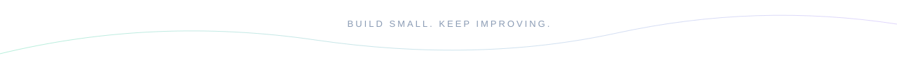

# 안녕하세요, Olimjon입니다 👋

### AI 도구 · 풀스택 제품 · 직접 만들며 배우기

[English](README.md) · **한국어**

## 👋 소개

안녕하세요, **Olimjon Tojiboev**입니다. AI 미디어 도구와 풀스택 제품을 직접 만들며 배우고 있습니다. 관심 있는 아이디어를 실제 인터페이스와 백엔드 흐름으로 연결하고, 테스트와 개선을 통해 완성도를 높입니다.

현재는 AI 영상 제작 흐름, 지역 커뮤니티 서비스, 우즈베크어·한국어·영어 인터페이스에 집중하고 있습니다.

## 🚀 주요 프로젝트

<table>
<tr>
<td width="50%" valign="top">
<h3>🎬 Flow AI Agents</h3>

3D Virtual Office, Media Studio, FFmpeg 내보내기와 사용자 승인을 연결하는 AI 숏폼 작업 공간입니다.

<code>Next.js</code> <code>FastAPI</code> <code>Three.js</code> <code>FFmpeg</code>

공개 프로토타입 · 개발 중
</td>
<td width="50%" valign="top">
<h3>🌿 ZUNO Web</h3>

우즈베키스탄과 한국의 지역 상품 탐색, 중고거래 등록, 대화와 계정 기능을 제공하는 마켓플레이스입니다.

<code>Next.js</code> <code>TypeScript</code> <code>Supabase</code> <code>Tailwind</code>

공개 소스 · 마켓플레이스 프로젝트
</td>
</tr>
</table>

## 🔧 함께 개발 중인 프로젝트

- **ZUNO Admin** · 비공개 소스 — MFA와 감사 기록을 사용하는 별도의 운영자 콘솔. Next.js · Supabase.
- **ZUNO Mobile** · 비공개 소스 — 네이티브 탐색과 인증 복귀 검증을 갖춘 Expo / React Native WebView 앱.

## 🛠️ 프로젝트에서 사용하는 도구

## 🎯 현재 집중하는 작업

- 조사, 대본, 영상과 편집을 검토 가능한 AI 작업 흐름으로 연결하기.
- 이해하기 쉬운 다국어 화면과 일관된 사용자 경험 만들기.
- 작업 복구, 제공자 진단, 테스트와 비용 통제 개선하기.

## 🐍 공개 학습 기록

[Python learning](https://github.com/olimjon03/python-learning)에서 Python 기본기, 연습 문제와 Blackjack·Tic-Tac-Toe·War 같은 터미널 프로젝트를 기록합니다.

## 🧭 개발 방식

**작은 흐름 구현 → 테스트 → 검토 → 개선.**

프로젝트 설명에는 현재 구현된 범위를 표시합니다. 영상 제작에서는 시뮬레이션 결과를 구분하고, 게시 전 사용자 승인을 유지합니다.

📊 공개 GitHub 활동

 

아래 이미지는 외부 서비스가 표시하는 공개 활동입니다. 이용할 수 없으면 GitHub 프로필에서 확인하세요.

<a href="https://github.com/olimjon03">GitHub에서 활동 확인</a>

### 직접 만든 프로젝트와 함께 성장하고 있습니다.

[공개 저장소 둘러보기](https://github.com/olimjon03?tab=repositories) · [GitHub 프로필](https://github.com/olimjon03)

