<div align="center">


[English](README.md) · **한국어**

<p>
<a href="https://github.com/olimjon03"></a>
<a href="https://github.com/olimjon03?tab=repositories"></a>
<a href="https://github.com/olimjon03/python-learning"></a>
</p>

<p>

<br /><sub>페이지 조회 수이며 순 방문자 수가 아닙니다.</sub>
</p>


</div>


<p align="center">
<a href="https://www.instagram.com/mrtojiboev/">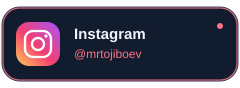</a>
<a href="https://www.facebook.com/mr_olimjon_">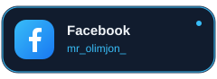</a>
<a href="https://www.linkedin.com/in/olimjon-tojiboev-685014449/">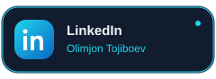</a>
<br />
<a href="mailto:olimjon260303@gmail.com"></a>
</p>

<div align="center">

## 01 / 소개

</div>

<div align="center">
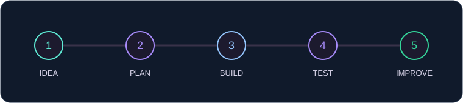

**Olimjon Tojiboev**입니다. AI 도구와 풀스택 제품을 직접 만들며 개발 역량을 키우고 있습니다. 유용한 화면과 실제 백엔드 흐름을 연결하고, 테스트와 검토를 통해 개선하는 데 집중합니다.
</div>

<table align="center">
<tr>
<td width="50%" valign="top">

### 🧭 학습과 프로젝트 방향

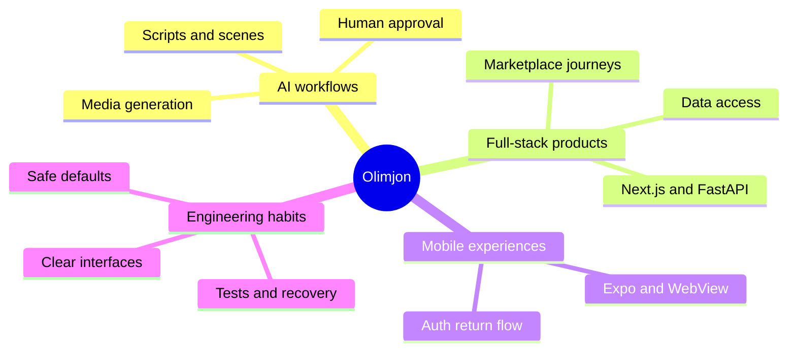

</td>
<td width="50%" valign="top">

### 💼 직접 만드는 프로젝트

```diff
@@ Projects I build @@
+ Flow AI Agents — AI media workflows
+ ZUNO Web — neighborhood marketplace
+ ZUNO Admin — staff console
+ ZUNO Mobile — mobile companion
+ Python — fundamentals and projects

@@ Engineering habits @@
+ Build a small working flow
+ Test with synthetic data
+ Keep secrets server-side
+ Review before publishing
+ Document limits and improve
```

</td>
</tr>
<tr>
<td colspan="2" align="center">

### 🔬 관심 분야

<table><tr>
<td align="center" width="50%"><br /><b>AI Agents</b><br /><sub>작업 흐름과 검토</sub></td>
<td align="center" width="50%"><br /><b>AI Media</b><br /><sub>영상·오디오·자막</sub></td>
</tr><tr>

<td align="center" width="50%">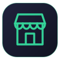<br /><b>Full-Stack Products</b><br /><sub>지역 서비스와 사용자 경험</sub></td>
<td align="center" width="50%">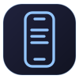<br /><b>Mobile Experiences</b><br /><sub>WebView와 네이티브 탐색</sub></td>
</tr></table>

**우즈베크어 사용자 중심의 제품** · **다국어 인터페이스** · **프로젝트로 배우는 개발**

</td>
</tr>
</table>


<div align="center">

## 🛠️ 기술과 도구

</div>

<div align="center">

### 💻 주요 언어


<sub>백엔드, 인터페이스와 데이터베이스 작업에 사용하는 언어입니다.</sub>


### 🤖 생성형 AI와 에이전트 흐름


<sub>서버 제공자 연동과 구조화된 에이전트 흐름을 개발합니다. 기본 모드는 mock입니다.</sub>


### 🌐 프론트엔드와 제품 인터페이스


<sub>화면 크기에 맞는 대시보드, 거래 흐름과 읽기 쉬운 인터페이스를 만듭니다.</sub>


### ⚙️ 백엔드와 API


<sub>입력 검증, 비동기 작업, 제공자 경계와 작업 상태 저장에 집중합니다.</sub>


### 🧊 인터랙티브 3D와 성능


<sub>카메라 조작, 에이전트 선택과 접근 가능한 대체 화면을 갖춘 가상 오피스입니다.</sub>


### 🎬 영상·오디오·미디어


<sub>장면 정규화, 오디오·자막 합성, 클립 가져오기와 검토 가능한 내보내기를 연결합니다.</sub>


### 🗄️ 데이터베이스와 접근 제어


<sub>거래 데이터의 소유자 범위 접근과 별도 운영자 권한 경계를 유지합니다.</sub>


### 📱 모바일과 크로스 플랫폼


<sub>WebView 앱과 인증 복귀 흐름을 다룹니다. 실기기 검증은 별도 단계입니다.</sub>


### 🔄 작업 흐름과 실시간 모니터링


<sub>실제 백엔드 작업 이벤트, 제한된 실행과 명확한 복구 상태를 연결합니다.</sub>


### 🧪 테스트와 개발 도구


<sub>제공자 mock 테스트, 브라우저 회귀와 임시 데이터베이스 테스트를 사용합니다.</sub>


### 🔒 책임 있는 AI와 안전 장치


<sub>명시적 승인, 예산 제한, 입력 검증과 서버 측 인증 정보를 관리합니다.</sub>

</div>


<div align="center">

## 03 / GitHub 활동 통계

</div>

<div align="center">
<p>


</p>
<p></p>

### 🧩 프로젝트 마일스톤

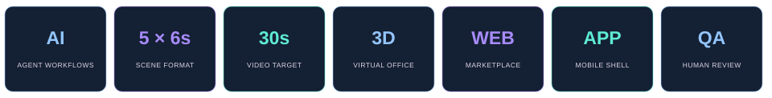

### 📅 공개 기여 캘린더

<a href="https://github.com/olimjon03"></a>

### 🐍 기여 캘린더 애니메이션

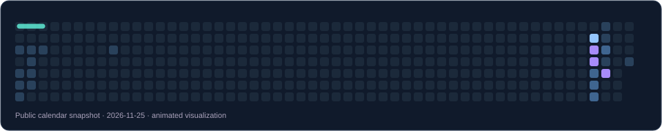

<sub>통계 카드는 외부 서비스의 공개 데이터이며 일시적으로 사용할 수 없을 수 있습니다. 언어 비율은 소스 구성이지 숙련도 점수가 아닙니다. 애니메이션은 2026-11-25 공개 캘린더 스냅샷입니다.</sub>

</div>


<div align="center">

## 04 / 주요 프로젝트와 시스템

</div>

<table><tr>
<td align="center" width="50%" valign="top"><h3>Flow AI Agents</h3><p><b>AI 영상 제작 작업 공간</b></p><sub>3D 오피스 · Media Studio<br />FFmpeg · 검토와 승인<br />개발 중인 공개 프로토타입</sub><br /><br /><a href="https://github.com/olimjon03/flow-ai-agents"></a></td>
<td align="center" width="50%" valign="top"><h3>ZUNO Web</h3><p><b>지역 중고거래 서비스</b></p><sub>우즈베키스탄 + 한국<br />상품 · 대화 · 계정<br />Next.js + Supabase</sub><br /><br /><a href="https://github.com/olimjon03/zuno-web"></a></td>
</tr><tr>

<td align="center" width="50%" valign="top"><h3>ZUNO Admin</h3><p><b>운영자 콘솔</b></p><sub>직원 권한 · MFA<br />신고와 감사 기록<br />비공개 소스</sub><br /><br /></td>
<td align="center" width="50%" valign="top"><h3>ZUNO Mobile</h3><p><b>모바일 WebView 앱</b></p><sub>Expo + React Native<br />네이티브 탐색 · 인증 복귀<br />비공개 소스</sub><br /><br /></td>
</tr></table>

**학습 저장소:** [Python learning](https://github.com/olimjon03/python-learning) — 기본기, 연습 문제, Blackjack, Tic-Tac-Toe, War.

### 🏆 프로젝트에서 쌓는 경험

<table><tr>
<td width="33%" align="center"><h3>🎬 미디어 작업 흐름</h3><p><b>5 × 6 seconds → 30-second target</b></p><sub>장면 계획, 클립 가져오기, 오디오·자막과 검토 가능한 MP4를 연결합니다. 기본 테스트는 mock입니다.</sub></td>
<td width="33%" align="center"><h3>🌿 ZUNO Ecosystem</h3><p><b>Web · Admin · Mobile</b></p><sub>마켓플레이스와 운영자 권한을 분리하고 모바일 사용 흐름을 개선합니다.</sub></td>
<td width="33%" align="center"><h3>🐍 Python 학습</h3><p><b>Practice → Projects → Improvement</b></p><sub>작은 프로그램과 터미널 게임으로 기본기를 익히고 개선 과정을 기록합니다.</sub></td>
</tr></table>


<div align="center">

## 05 / 현재 집중하는 작업

</div>

<table align="center">
<tr><td>🔭 AI 에이전트와 영상 제작을 검토 가능한 흐름으로 연결하기</td></tr>
<tr><td>🌱 Python·TypeScript와 풀스택 설계 역량 강화하기</td></tr>
<tr><td>🎨 이해하기 쉬운 대시보드와 3D 가상 오피스 개선하기</td></tr>
<tr><td>📱 모바일 탐색, 오류 복구와 인증 복귀 흐름 검증하기</td></tr>
<tr><td>🌐 우즈베크어·한국어·영어 인터페이스 개선하기</td></tr>
<tr><td>🔒 사용자 검토, 비용 통제와 데이터 경계 유지하기</td></tr>
</table>


<div align="center">

## 06 / 개발 방식

</div>

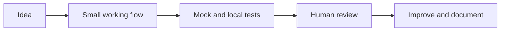

작은 기능을 실제로 연결한 뒤 테스트하고 제한 사항을 기록합니다. 영상 게시·유료 생성은 해당 프로젝트의 명시적 승인 절차를 따릅니다. 실기기 및 운영 환경 검증은 별도 단계입니다.


<div align="center">

## 07 / 함께 이야기해요

</div>

<div align="center">
<p>
<a href="https://github.com/olimjon03"></a>
<a href="https://github.com/olimjon03?tab=repositories"></a>
<a href="https://github.com/olimjon03/python-learning"></a>
</p>

### 이런 주제에 관심이 있습니다

🤖 실용적인 AI 도구 · 🌐 풀스택 제품 · 🎬 미디어 자동화 · 📚 프로젝트 기반 학습

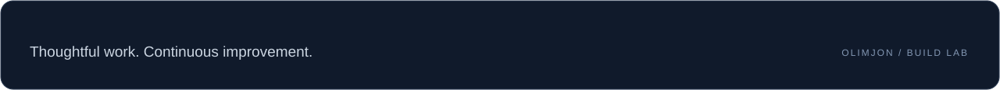

### ⭐ 도움이 된 프로젝트가 있다면 Star로 응원해 주세요!

직접 만들고, 테스트하고, 개선하며 성장합니다.

**Made with curiosity & care · Olimjon Tojiboev · 2026**

</div>
