<div align="center">




**English** · [한국어](README.ko.md)

<p>
<a href="https://github.com/olimjon03"></a>
<a href="https://github.com/olimjon03?tab=repositories"></a>
<a href="https://github.com/olimjon03/python-learning"></a>
</p>


</div>


<div align="center">

## 01 / About Me

</div>

<div align="center">
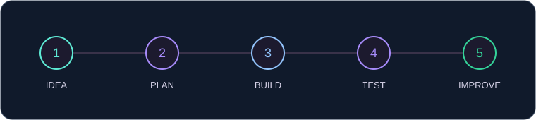

I’m **Olimjon Tojiboev**. I build practical AI tools and full-stack products while developing my engineering skills through real projects. I focus on connecting useful interfaces with backend workflows, testing what I build and improving it through review.
</div>

<table align="center">
<tr>
<td width="50%" valign="top">

### 🧭 Learning & Project Focus

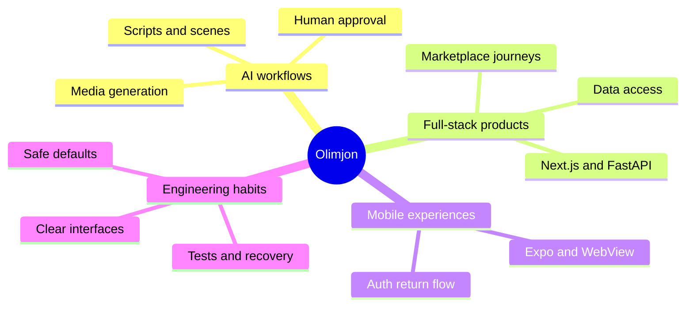

</td>
<td width="50%" valign="top">

### 💼 My Builder Journey

```diff
@@ Projects I build @@
+ Flow AI Agents — AI media workflows
+ ZUNO Web — neighborhood marketplace
+ ZUNO Admin — staff console
+ ZUNO Mobile — mobile companion
+ Python — fundamentals and projects

@@ Engineering habits @@
+ Build a small working flow
+ Test with synthetic data
+ Keep secrets server-side
+ Review before publishing
+ Document limits and improve
```

</td>
</tr>
<tr>
<td colspan="2" align="center">

### 🔬 Areas I Explore

<table><tr>
<td align="center" width="50%">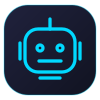<br /><b>AI Agents</b><br /><sub>Workflows & review</sub></td>
<td align="center" width="50%"><br /><b>AI Media</b><br /><sub>Video, audio & subtitles</sub></td>
</tr><tr>

<td align="center" width="50%">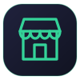<br /><b>Full-Stack Products</b><br /><sub>Community products & UX</sub></td>
<td align="center" width="50%">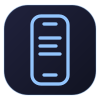<br /><b>Mobile Experiences</b><br /><sub>WebView & navigation</sub></td>
</tr></table>

**Products for Uzbek-speaking audiences** · **Multilingual interfaces** · **Learning through projects**

</td>
</tr>
</table>


<div align="center">

## 02 / Technical Arsenal

</div>

<div align="center">

<table>
<tr>
<td width="50%" valign="top">

### 💻 Core Languages


<sub>Languages used across my backend, interface and database work.</sub>

</td>
<td width="50%" valign="top">

### 🤖 Generative AI & Agent Workflows


<sub>Server-side provider integration and structured agent workflows; mock mode is the safe default.</sub>

</td>
</tr>
<tr>
<td width="50%" valign="top">

### 🌐 Frontend & Product Interfaces


<sub>Dashboards, marketplace journeys and interfaces that stay readable across screen sizes.</sub>

</td>
<td width="50%" valign="top">

### ⚙️ Backend & API Engineering


<sub>Validated inputs, asynchronous tasks, provider boundaries and persistent job state.</sub>

</td>
</tr>
<tr>
<td width="50%" valign="top">

### 🧊 Interactive 3D & Performance


<sub>A virtual agent office with camera controls, workstation selection and accessible fallback views.</sub>

</td>
<td width="50%" valign="top">

### 🎬 Video, Audio & Media


<sub>Scene normalization, audio/subtitle assembly, clip imports and reviewable exports.</sub>

</td>
</tr>
<tr>
<td width="50%" valign="top">

### 🗄️ Databases & Access Control


<sub>Marketplace data, owner-scoped access and a separate staff-console permission boundary.</sub>

</td>
<td width="50%" valign="top">

### 📱 Mobile & Cross-Platform


<sub>A WebView companion and mobile auth-return handling; native device acceptance is a separate check.</sub>

</td>
</tr>
<tr>
<td width="50%" valign="top">

### 🔄 Workflow & Live Monitoring


<sub>Real backend task events, bounded execution and explicit recovery states.</sub>

</td>
<td width="50%" valign="top">

### 🧪 Testing & Development Tools


<sub>Mocked provider tests, browser regressions and disposable database fixtures.</sub>

</td>
</tr>
<tr>
<td width="50%" valign="top">

### 🔒 Responsible AI & Engineering Safety


<sub>Explicit approval, bounded budgets, input checks and server-side credentials.</sub>

</td>
<td width="50%" valign="top">

**Working principles**

Clear interfaces · Testable workflows · Safe defaults · Continuous improvement

</td>
</tr>
</table>

</div>


<div align="center">

## 03 / GitHub Analytics

</div>

<div align="center">
<p>


</p>
<p></p>

### 🧩 Development Milestones

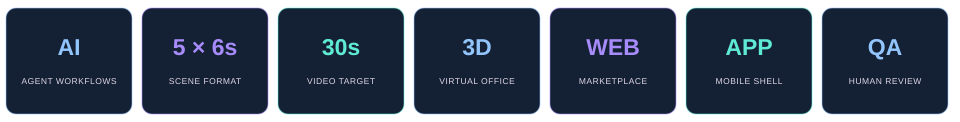

### 📅 Public Contribution Calendar

<a href="https://github.com/olimjon03"></a>

### 🐍 Contribution Snake

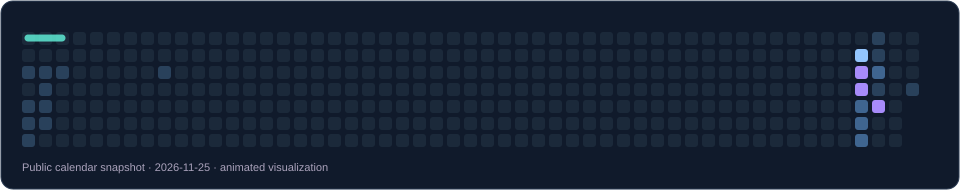

<sub>Statistics use public data through third-party services and may be temporarily unavailable. Language percentages describe source composition, not proficiency. The animated calendar is a dated public snapshot: 2026-11-25.</sub>

</div>


<div align="center">

## 04 / Featured Projects & Systems

</div>

<table><tr>
<td align="center" width="50%" valign="top"><h3>Flow AI Agents</h3><p><b>AI Video Workspace</b></p><sub>3D Office · Media Studio<br />FFmpeg · Review & approval<br />Public prototype in development</sub><br /><br /><a href="https://github.com/olimjon03/flow-ai-agents"></a></td>
<td align="center" width="50%" valign="top"><h3>ZUNO Web</h3><p><b>Neighborhood Marketplace</b></p><sub>Uzbekistan + South Korea<br />Listings · Chat · Accounts<br />Next.js + Supabase</sub><br /><br /><a href="https://github.com/olimjon03/zuno-web"></a></td>
</tr><tr>

<td align="center" width="50%" valign="top"><h3>ZUNO Admin</h3><p><b>Staff Console</b></p><sub>Staff access · MFA<br />Reports & audit trails<br />Private source</sub><br /><br /></td>
<td align="center" width="50%" valign="top"><h3>ZUNO Mobile</h3><p><b>Mobile WebView Companion</b></p><sub>Expo + React Native<br />Navigation · Auth return<br />Private source</sub><br /><br /></td>
</tr></table>

**Learning repository:** [Python learning](https://github.com/olimjon03/python-learning) — fundamentals, exercises, Blackjack, Tic-Tac-Toe and War.

### 🏆 Progress Through Projects

<table><tr>
<td width="33%" align="center"><h3>🎬 Media Workflows</h3><p><b>5 × 6 seconds → 30-second target</b></p><sub>Connecting scene plans, clip imports, audio, subtitles and a reviewable MP4. Mock-first testing stays available.</sub></td>
<td width="33%" align="center"><h3>🌿 ZUNO Ecosystem</h3><p><b>Web · Admin · Mobile</b></p><sub>Building a marketplace, a separate staff boundary and a mobile companion around consistent user journeys.</sub></td>
<td width="33%" align="center"><h3>🐍 Python Foundations</h3><p><b>Practice → Projects → Improvement</b></p><sub>Practicing fundamentals through small programs and terminal games, then documenting what improves.</sub></td>
</tr></table>


<div align="center">

## 05 / Current Focus

</div>

<table align="center">
<tr><td>🔭 Connecting AI agents and media production into a reviewable workflow</td></tr>
<tr><td>🌱 Strengthening Python, TypeScript and full-stack architecture skills</td></tr>
<tr><td>🎨 Improving clear dashboards and the interactive 3D Virtual Office</td></tr>
<tr><td>📱 Validating mobile navigation, recovery and auth-return journeys</td></tr>
<tr><td>🌐 Building readable Uzbek, Korean and English interfaces</td></tr>
<tr><td>🔒 Keeping human review, cost controls and data boundaries in the workflow</td></tr>
</table>


<div align="center">

## 06 / My Development Workflow

</div>

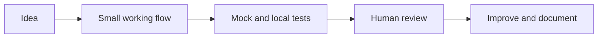

I connect a small working feature, test it and document its limits before expanding it. Paid generation and video publishing follow explicit approval controls in the projects that support them. Native-device and production acceptance are separate checks.


<div align="center">

## 07 / Let’s Connect & Build

</div>

<div align="center">
<p>
<a href="https://github.com/olimjon03"></a>
<a href="https://github.com/olimjon03?tab=repositories"></a>
<a href="https://github.com/olimjon03/python-learning"></a>
</p>

### Conversations I’m interested in

🤖 Practical AI tools · 🌐 Full-stack products · 🎬 Creative automation · 📚 Learning through projects

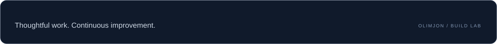

### ⭐ If a project helps you, a star is appreciated!

Building, testing and improving — one useful project at a time.

**Made with curiosity & care · Olimjon Tojiboev · 2026**

</div>
