# Hi, I’m Olimjon 👋

### AI tools · Full-stack products · Learning by building

**English** · [한국어](README.ko.md)

## 👋 About me

I’m **Olimjon Tojiboev**. I build and learn through practical AI tools and full-stack products — connecting ideas to interfaces, backend workflows and software that can be tested and improved.

My current work focuses on AI-assisted video workflows, local community products and interfaces in Uzbek, Korean and English.

## 🚀 Featured projects

<table>
<tr>
<td width="50%" valign="top">
<h3>🎬 Flow AI Agents</h3>

AI-assisted short-video workspace with a 3D Virtual Office, Media Studio, FFmpeg export and human approval.

<code>Next.js</code> <code>FastAPI</code> <code>Three.js</code> <code>FFmpeg</code>

Public prototype · active development
</td>
<td width="50%" valign="top">
<h3>🌿 ZUNO Web</h3>

A neighborhood marketplace for Uzbekistan and South Korea: local discovery, listings, conversations and account tools.

<code>Next.js</code> <code>TypeScript</code> <code>Supabase</code> <code>Tailwind</code>

Public source · marketplace project
</td>
</tr>
</table>

## 🔧 Also building

- **ZUNO Admin** · Private source — A separate staff console with MFA and audited moderation. Next.js · Supabase.
- **ZUNO Mobile** · Private source — An Expo / React Native WebView companion with native navigation and validated auth return routing.

## 🛠️ Tools I use in my projects

## 🎯 What I’m working on

- Connecting research, scripts, video and editing into reviewable AI workflows.
- Designing clear multilingual interfaces and consistent user journeys.
- Improving recovery, provider diagnostics, tests and cost controls.

## 🐍 Learning in public

My [Python learning](https://github.com/olimjon03/python-learning) repository documents fundamentals, exercises and terminal projects including Blackjack, Tic-Tac-Toe and War.

## 🧭 How I build

**Build a small working flow → test it → review it → improve it.**

Project descriptions reflect what is implemented today. Simulated media is labeled, and video publishing remains subject to human approval.

📊 Public GitHub activity

 

This optional chart shows public contributions through a third-party service. If it is unavailable, use the GitHub profile link below.

<a href="https://github.com/olimjon03">View activity directly on GitHub</a>

### Building useful things. Learning with every iteration.

[Explore my public repositories](https://github.com/olimjon03?tab=repositories) · [GitHub profile](https://github.com/olimjon03)

